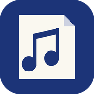

  

<h1 align="center">PdfMusicCraft</h1>

  <b>Read and mark up PDF scores on an Android tablet.</b> 
  <b>Lee y anota partituras en PDF en una tableta Android.</b>

  <a href="https://github.com/PabloGonSan8/pdfmusiccraft/releases/latest"><b>⬇ Download / Descargar</b></a>
  ·
  <a href="apps/pdfcraft-android/INSTALL.md">How to install</a>
  ·
  <a href="apps/pdfcraft-android/INSTALL.es.md">Cómo instalar</a>
  ·
  <a href="https://github.com/PabloGonSan8/pdfmusiccraft/issues">Report a bug / Informar de un fallo</a>

  
  
  

## Where it comes from / De dónde viene

PdfMusicCraft is a fork of **[PdfCraft](https://github.com/storytold/pdfcraft)**
([storytold/pdfcraft](https://github.com/storytold/pdfcraft)), an open-source PDF reader and
editor written in Rust by the ArtCraft team. It keeps PdfCraft's engine and adds a touch
interface for musicians on Android. It is an independent adaptation: it isn't made, endorsed or
supported by the PdfCraft or ArtCraft teams, so please report problems with this app
[here](https://github.com/PabloGonSan8/pdfmusiccraft/issues), not upstream.

PdfMusicCraft es un fork de **[PdfCraft](https://github.com/storytold/pdfcraft)**
([storytold/pdfcraft](https://github.com/storytold/pdfcraft)), un lector y editor de PDF de
código abierto escrito en Rust por el equipo de ArtCraft. Usa el motor de PdfCraft y le añade una
interfaz táctil para músicos en Android. Es una adaptación independiente: ni el equipo de
PdfCraft ni el de ArtCraft la hacen, respaldan o mantienen, así que los fallos de esta app se
cuentan [aquí](https://github.com/PabloGonSan8/pdfmusiccraft/issues), no en el proyecto original.

## What it does

- **Scores**: the PDFs in Download and Documents as cards, with search. Each folder of PDFs is a
  **concert**: go through its pieces with Previous and Next, or by swiping past the last page.
- **Music view**: the score full screen, fitted to its music. Swipe sideways to turn the page,
  drag to move, pinch to zoom.
- **Marks** drawn into the PDF, so any PDF reader shows them: dynamics (ppp–fff, sfz, fp),
  hairpins and slurs, tempo (Allegro, Andante…, rit., accel.) and metronome marks (♩ = 120 with
  any note), articulations, bowing and pedal, fingering, rehearsal letters, bar numbers, and
  notes you write in yourself (whole to sixteenth, dotted, stem up or down).
- **Jumps**: segno, coda, D.S., D.C. and lettered jumps; a tap on one takes you to the other end.
- **Pencil, highlighter and eraser** for handwriting.
- **The full PdfCraft editor** one tap away, for anything else.

All the details: [apps/pdfcraft-android/README.md](apps/pdfcraft-android/README.md).

## Qué hace

- **Partituras**: los PDF de Descargas y Documentos como tarjetas, con buscador. Cada carpeta
  con PDF es un **concierto**: pasa de una obra a otra con Anterior y Siguiente, o deslizando
  después de la última página.
- **Vista de música**: la partitura a pantalla completa, ajustada a la música. Desliza de lado
  para pasar página, arrastra para moverte y pellizca para hacer zoom.
- **Marcas** dibujadas dentro del PDF, que cualquier lector de PDF muestra: dinámicas (ppp–fff,
  sfz, fp), reguladores y ligaduras, tempo (Allegro, Andante…, rit., accel.) y metrónomo (♩ = 120
  con cualquier figura), articulaciones, arco y pedal, digitación, letras de ensayo, números de
  compás y notas escritas a mano (de redonda a semicorchea, con puntillo, plica arriba o abajo).
- **Saltos**: segno, coda, D.S., D.C. y saltos con letra; al tocar uno vas al otro extremo.
- **Lápiz, subrayador y goma** para escribir a mano.
- **El editor completo de PdfCraft** a un toque, para todo lo demás.

## Building / Compilar

See [Building and installing](apps/pdfcraft-android/README.md#building-and-installing). The rest
of this repository is PdfCraft's code; its own documentation is in
[PdfCraft's README](https://github.com/storytold/pdfcraft#readme).

## License / Licencia

Like PdfCraft, PdfMusicCraft is dual-licensed under [MIT](LICENSE-MIT) or
[Apache-2.0](LICENSE-APACHE), at your option. The notices the licences require are in
[NOTICE](NOTICE), and every bundled asset is credited in [ATTRIBUTION.md](ATTRIBUTION.md).
"PdfCraft" and "ArtCraft" are names of their respective owners.

Como PdfCraft, PdfMusicCraft tiene doble licencia [MIT](LICENSE-MIT) o
[Apache-2.0](LICENSE-APACHE), a tu elección. Los avisos que exigen las licencias están en
[NOTICE](NOTICE), y cada recurso incluido está acreditado en [ATTRIBUTION.md](ATTRIBUTION.md).
