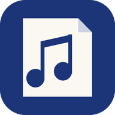

  

<h1 align="center">PdfMusicCraft</h1>

  <b>An open-source Android sheet music reader and annotator: dedicated musical symbols, marks saved into the PDF, no account and no internet needed.</b> 
  <b>Lector y anotador de partituras PDF para Android, de código abierto: símbolos musicales propios, marcas guardadas en el PDF, sin cuenta y sin conexión.</b>

  <a href="https://github.com/PabloGonSan8/pdfmusiccraft/releases/latest"><b>⬇ Download / Descargar</b></a>
  ·
  <a href="https://pdfmusiccraft.netlify.app/">Website / Web</a>
  ·
  <a href="apps/pdfcraft-android/INSTALL.md">How to install</a>
  ·
  <a href="apps/pdfcraft-android/INSTALL.es.md">Cómo instalar</a>
  ·
  <a href="https://github.com/PabloGonSan8/pdfmusiccraft/issues/new/choose">Report a bug / Informar de un fallo</a>

  
  
  
  
  

  

**English** · [Español](#español)

## Why PdfMusicCraft

Ordinary PDF readers are made for documents: their notes are sticky notes and text boxes, and
their tools sit behind menus. Musicians on a stand need something else: the score full screen,
a page turn with one swipe, and the marks they already write in pencil.

PdfMusicCraft is a PDF reader built for scores. It is for pianists, string and wind players,
guitarists, singers, conductors, students and teachers who read from a tablet (it works on
phones too).

- **Musical symbols, not sticky notes.** Dynamics, hairpins, slurs, tempo and metronome marks,
  articulations, bowing, pedal, fingering, rehearsal letters, bar numbers and written notes.
- **Marks live in the PDF.** On **Save** they are drawn into the file itself, so any PDF reader,
  on any device, shows them. No proprietary layer, no export step.
- **Jumps you can follow.** Segno, coda, D.S., D.C. and lettered jumps: a tap takes you to the
  other end.
- **Concerts from folders.** Each folder of PDFs is a concert: go through its pieces with
  Previous and Next, or by swiping past the last page.
- **Offline and private.** No account, no ads, and the app does not ask Android for internet
  access. See [PRIVACY.md](PRIVACY.md).
- **Free software.** MIT or Apache-2.0, built on the [PdfCraft](https://github.com/storytold/pdfcraft)
  engine, in Rust.

## What it does

- **Scores**: the PDFs in Download and Documents as cards, with search and recent files. Folders
  of PDFs show as **concerts**.
- **Music view**: the score full screen, fitted to its music (not to a scan's margins). Swipe
  sideways to turn the page, drag to move, pinch to zoom; turning the tablet fits it again.
- **Marks**: dynamics (ppp–fff, sfz, fp), hairpins and slurs, tempo headings (Grave to Presto),
  tempo changes (rit., rall., accel., a tempo…), metronome marks (♩ = 120 with any note),
  articulations, bowing and pedal, fingering, rehearsal letters, numbers, and notes you write in
  yourself (whole to sixteenth, dotted, stem up or down, loose note heads).
- **Move and Size**: drag a mark, pull its corners, or use Larger and Smaller.
- **Pencil** (grey, blue, red, green and white to cover print), **highlighter** (six colours,
  three widths) and **eraser** (three sizes).
- **The full PdfCraft editor** one tap away, for reordering, rotating or deleting pages and
  anything else.

The complete list of marks and gestures: [apps/pdfcraft-android/README.md](apps/pdfcraft-android/README.md).
What changed in each version: [CHANGELOG.md](apps/pdfcraft-android/CHANGELOG.md).
What comes next: [ROADMAP](apps/pdfcraft-android/ROADMAP.md).

  
  

## Download and install

| | |
|---|---|
| **Where** | [GitHub Releases](https://github.com/PabloGonSan8/pdfmusiccraft/releases/latest) and the [website](https://pdfmusiccraft.netlify.app/). Not on Google Play. |
| **Android** | 8.0 (API 26) or later |
| **Devices** | 64-bit ARM (`arm64-v8a`): almost every current tablet and phone. No x86 or 32-bit build. |
| **Download** | one `.apk` of about 32 MB; about 200 MB free once installed |
| **Integrity** | each release lists the APK's SHA-256; how to check it: [INSTALL.md](apps/pdfcraft-android/INSTALL.md#check-the-download-sha-256) |
| **Updates** | install the new APK over the old one, or let [Obtainium](https://github.com/ImranR98/Obtainium) do it |

Step by step: [INSTALL.md](apps/pdfcraft-android/INSTALL.md) · [INSTALL.es.md](apps/pdfcraft-android/INSTALL.es.md).

## Contributing

Bug reports, ideas and pull requests are welcome.

- **Found a bug?** [Open a bug report](https://github.com/PabloGonSan8/pdfmusiccraft/issues/new?template=bug_report.yml)
  with your device, Android version and app version.
- **Missing a mark or a tool?** [Suggest a feature](https://github.com/PabloGonSan8/pdfmusiccraft/issues/new?template=feature_request.yml).
- **Want to code?** Read [CONTRIBUTING.md](CONTRIBUTING.md): how to build the APK, where the
  music code lives, and the project's rules.
- **Security problem?** See [SECURITY.md](SECURITY.md); please don't open a public issue.

## Where it comes from

PdfMusicCraft is a fork of **[PdfCraft](https://github.com/storytold/pdfcraft)**, an open-source
PDF reader and editor written in Rust by the ArtCraft team. It keeps PdfCraft's engine and editor
and adds the touch interface and musical marks for Android. It is an independent adaptation: it
isn't made, endorsed or supported by the PdfCraft or ArtCraft teams, so please report problems
with this app [here](https://github.com/PabloGonSan8/pdfmusiccraft/issues), not upstream.

Most of this repository is PdfCraft's code; its own documentation (including the root
[ROADMAP.md](ROADMAP.md), which is PdfCraft's) is described in
[PdfCraft's README](https://github.com/storytold/pdfcraft#readme).

## License

Like PdfCraft, PdfMusicCraft is dual-licensed under [MIT](LICENSE-MIT) or
[Apache-2.0](LICENSE-APACHE), at your option. The notices the licences require are in
[NOTICE](NOTICE), and every bundled asset is credited in [ATTRIBUTION.md](ATTRIBUTION.md).
"PdfCraft" and "ArtCraft" are names of their respective owners.

---

## Español

### Por qué PdfMusicCraft

Los lectores de PDF normales están pensados para documentos: sus notas son posits y cuadros de
texto, y sus herramientas están escondidas en menús. En el atril hace falta otra cosa: la
partitura a pantalla completa, pasar página con un gesto y las marcas que ya escribes a lápiz.

PdfMusicCraft es un lector de PDF hecho para partituras. Es para pianistas, cuerda y viento,
guitarristas, cantantes, directores, estudiantes y profesores que leen desde una tableta
(también funciona en el móvil).

- **Símbolos musicales, no posits.** Dinámicas, reguladores, ligaduras, tempo y metrónomo,
  articulaciones, arco, pedal, digitación, letras de ensayo, números de compás y notas escritas.
- **Las marcas viven en el PDF.** Al **Guardar** se dibujan dentro del archivo, así que cualquier
  lector de PDF, en cualquier dispositivo, las muestra. Sin capas propietarias ni exportaciones.
- **Saltos que se siguen.** Segno, coda, D.S., D.C. y saltos con letra: un toque te lleva al otro
  extremo.
- **Conciertos desde carpetas.** Cada carpeta con PDF es un concierto: pasa de una obra a otra
  con Anterior y Siguiente, o deslizando después de la última página.
- **Sin conexión y privada.** Sin cuenta, sin anuncios, y la app no pide a Android acceso a
  internet. Más en [PRIVACY.md](PRIVACY.md#español).
- **Software libre.** MIT o Apache-2.0, sobre el motor de
  [PdfCraft](https://github.com/storytold/pdfcraft), en Rust.

### Qué hace

- **Partituras**: los PDF de Descargas y Documentos como tarjetas, con buscador y recientes. Las
  carpetas con PDF aparecen como **conciertos**.
- **Vista de música**: la partitura a pantalla completa, ajustada a la música (no a los márgenes
  del escaneo). Desliza de lado para pasar página, arrastra para moverte y pellizca para hacer
  zoom; al girar la tableta se vuelve a ajustar.
- **Marcas**: dinámicas (ppp–fff, sfz, fp), reguladores y ligaduras, tempo (de Grave a Presto),
  cambios de tempo (rit., rall., accel., a tempo…), metrónomo (♩ = 120 con cualquier figura),
  articulaciones, arco y pedal, digitación, letras de ensayo, números y notas escritas a mano
  (de redonda a semicorchea, con puntillo, plica arriba o abajo, cabezas sueltas).
- **Mover y Tamaño**: arrastra una marca, o tira de sus esquinas para cambiar su tamaño.
- **Lápiz** (gris, azul, rojo, verde y blanco para tapar lo impreso), **subrayador** (seis
  colores, tres grosores) y **goma** (tres tamaños).
- **El editor completo de PdfCraft** a un toque, para reordenar, girar o borrar páginas y todo
  lo demás.

### Descargar e instalar

| | |
|---|---|
| **Dónde** | [GitHub Releases](https://github.com/PabloGonSan8/pdfmusiccraft/releases/latest) y la [web](https://pdfmusiccraft.netlify.app/). No está en Google Play. |
| **Android** | 8.0 (API 26) o posterior |
| **Dispositivos** | ARM de 64 bits (`arm64-v8a`): casi todas las tabletas y móviles actuales. No hay versión x86 ni de 32 bits. |
| **Descarga** | un `.apk` de unos 32 MB; unos 200 MB libres una vez instalada |
| **Integridad** | cada release indica el SHA-256 del APK; cómo comprobarlo: [INSTALL.es.md](apps/pdfcraft-android/INSTALL.es.md#comprobar-la-descarga-sha-256) |
| **Actualizar** | instala el APK nuevo encima del anterior, o deja que lo haga [Obtainium](https://github.com/ImranR98/Obtainium) |

Paso a paso: [INSTALL.es.md](apps/pdfcraft-android/INSTALL.es.md).

### Colaborar

- **¿Un fallo?** [Abre un informe](https://github.com/PabloGonSan8/pdfmusiccraft/issues/new?template=bug_report.yml)
  con tu dispositivo, versión de Android y versión de la app.
- **¿Echas de menos una marca o herramienta?** [Propón una mejora](https://github.com/PabloGonSan8/pdfmusiccraft/issues/new?template=feature_request.yml).
- **¿Quieres programar?** Lee [CONTRIBUTING.md](CONTRIBUTING.md).
- **¿Un problema de seguridad?** Mira [SECURITY.md](SECURITY.md); no abras una incidencia pública.

### De dónde viene

PdfMusicCraft es un fork de **[PdfCraft](https://github.com/storytold/pdfcraft)**, un lector y
editor de PDF de código abierto escrito en Rust por el equipo de ArtCraft. Usa el motor y el
editor de PdfCraft y le añade la interfaz táctil y las marcas musicales para Android. Es una
adaptación independiente: ni el equipo de PdfCraft ni el de ArtCraft la hacen, respaldan o
mantienen, así que los fallos de esta app se cuentan
[aquí](https://github.com/PabloGonSan8/pdfmusiccraft/issues), no en el proyecto original.

### Licencia

Como PdfCraft, PdfMusicCraft tiene doble licencia [MIT](LICENSE-MIT) o
[Apache-2.0](LICENSE-APACHE), a tu elección. Los avisos que exigen las licencias están en
[NOTICE](NOTICE), y cada recurso incluido está acreditado en [ATTRIBUTION.md](ATTRIBUTION.md).
